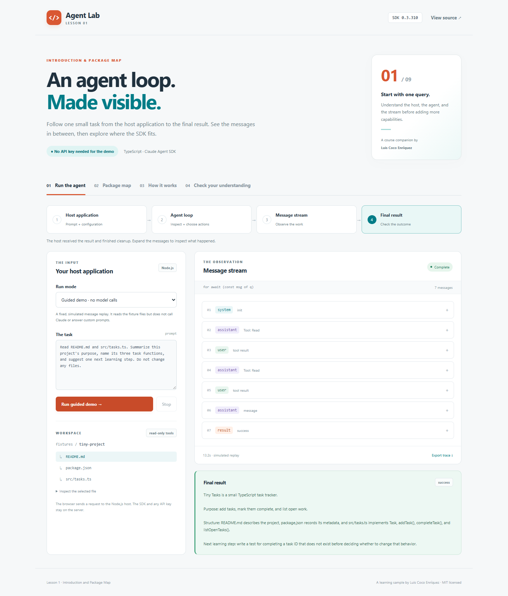
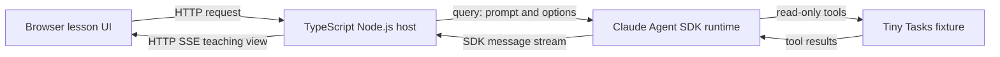

# Lesson 01 · Agent Lab

**A hands-on companion to “Claude Agent SDK TypeScript version 0.3.310” by Luis Coco Enríquez.**

See what sits between a prompt and an answer. This small application makes Lesson 1's host, agent loop, message stream, and final result visible, then lets you inspect the installed package's entry points.



## Start here

You need **Node.js 22.14 or newer**, npm, and Git. The guided demo needs no model account or API key.

```sh
git clone https://github.com/luiscoco/claude-agent-sdk-lesson-01.git
cd claude-agent-sdk-lesson-01
npm ci
npm run dev
```

Open **http://127.0.0.1:4311** and click **Run guided demo**.

The demo is a **simulated, fixed SDK-message replay**, not an AI response to an arbitrary prompt. It reads the bundled Tiny Tasks files so the tool-result examples match the fixture. It makes no model API requests. A network connection is needed to install npm dependencies; the installed demo itself runs locally.

## Follow the Lesson 1 walkthrough

1. **Run the agent.** Observe the host → agent → stream → result flow. Expand a message to see selected SDK fields and its explanation.
2. **Find the actual outcome.** Notice that `assistant` messages arrive before the final `result`. A result's subtype and error flag determine whether it succeeded.
3. **Explore the package map.** See the root, `/core`, `/sdk-tools`, and `/browser` entries read from the installed package's `exports` field.
4. **Read the small example.** Open [src/examples/first-query.ts](src/examples/first-query.ts); the live path uses `query()` and `for await` directly.
5. **Check your understanding.** Answer the four questions, then explain the flow without reading the notes. Export the trace if you want to compare message sequences.

For a classroom exercise and answer guide, see [docs/lesson-1-walkthrough.md](docs/lesson-1-walkthrough.md).

## Where the concepts live

| Lesson 1 concept                             | Application feature                                             | Code to inspect                                                                                                      |
| -------------------------------------------- | --------------------------------------------------------------- | -------------------------------------------------------------------------------------------------------------------- |
| The host supplies task and configuration     | Prompt and fixed Tiny Tasks workspace                           | [src/server/live.ts](src/server/live.ts)                                                                             |
| The agent may take multiple steps            | Read requests and tool results in the guided replay             | [src/server/demo.ts](src/server/demo.ts)                                                                             |
| The host consumes SDK messages               | Event timeline with `system`, `assistant`, `user`, and `result` | [src/server/messages.ts](src/server/messages.ts)                                                                     |
| The final result is part of the stream       | Separate outcome panel; success and error handling              | [src/client/main.ts](src/client/main.ts)                                                                             |
| Entry points have different responsibilities | Installed package map and compile-checked imports               | [src/server/package-map.ts](src/server/package-map.ts), [src/examples/entry-points.ts](src/examples/entry-points.ts) |
| Version and status matter                    | Exact SDK dependency and version/status notes                   | [package.json](package.json), [package-lock.json](package-lock.json)                                                 |



The browser's HTTP SSE connection is this application's transport. It is distinct from the SDK's asynchronous message iterator on Node.js. The root SDK and credentials are never bundled into client code.

## Optional: run the real SDK

1. Copy `.env.example` to `.env` in the repository root. On Windows PowerShell use `Copy-Item .env.example .env`; on macOS/Linux use `cp .env.example .env`.
2. Add your own `ANTHROPIC_API_KEY` to `.env`. Leave `ANTHROPIC_MODEL` empty to use the SDK's default model, or supply a model available to your account.
3. Restart `npm run dev`, select **Live SDK**, and run the query.

Live mode **does make billable model requests**. It passes the SDK a four-turn limit, a `$0.25` budget setting, no project/user setting sources, and only `Read`, `Glob`, and `Grep` as available built-in tools. `allowedTools` auto-approves those tools; it is **not** the availability restriction. `tools` supplies the base tool list. The host closes the query on completion, failure, or cancellation and aborts a run after 90 seconds.

`cwd` chooses a working directory; it is not an operating-system sandbox. This is a local, single-user teaching host that binds to `127.0.0.1`, not a service to expose publicly with a model key. It accepts no arbitrary workspace path from the browser. The bundled runtime is installed through the SDK's optional platform dependencies, so do not omit optional dependencies when installing for live use.

The real SDK adapter is type-checked against 0.3.310 and tested with an injected query handle for success, failure, missing results, and cancellation. A live model request requires a learner's own credentials; the default tests never call a model.

## Command-line companions

```sh
npm run demo:cli      # fixed replay, no model call
npm run package-map   # inspect the installed package exports
npm run live:cli      # real query; requires your server .env key
```

The CLI prints `message.type` as it iterates and checks a result before reading its text.

## Package map: what the example actually uses

The SDK dependency is pinned to **0.3.310**, not a version range. The browser map and CLI inspect that installed manifest rather than assuming a current or future export layout.

| Entry                                      | Lesson 1 meaning                                                                                        |
| ------------------------------------------ | ------------------------------------------------------------------------------------------------------- |
| `@anthropic-ai/claude-agent-sdk`           | The root entry used for our first Node.js query.                                                        |
| `@anthropic-ai/claude-agent-sdk/core`      | A focused entry for runtime/bundling use; it is not a browser-safe substitute for the Node.js host.     |
| `@anthropic-ai/claude-agent-sdk/sdk-tools` | Tool input/output **types**. Use `import type`; the 0.3.310 export has no runtime default target.       |
| `@anthropic-ai/claude-agent-sdk/browser`   | A separate browser-oriented surface. This sample's UI communicates with our own Node.js host over HTTP. |

The installed manifest also exposes additional entries and a type-only alias; the lab lists them separately. API stability is a different question from export availability: follow the relevant declaration comments and matching release notes. This lesson focuses on `query()`; custom tools, MCP registration, hooks, and subagents belong to later lessons.

## Build and verify

```sh
npm run check        # TypeScript, unit/API tests, and production build
npm start            # serve the production build at http://127.0.0.1:4311
```

For browser tests, install Playwright's browser once:

```sh
npx playwright install chromium
npm run test:e2e
```

The browser command builds the application and starts a separate production test server on port 4312. On Linux, Playwright may require `npx playwright install --with-deps chromium`. Browser tests cover the guided run, trace export, package map, quiz, cancellation, and phone-width layout.

GitHub Actions checks Node.js 22 and 24 and runs the browser suite without model credentials.

## Project layout

```text
src/
  examples/     Small runnable query and package-import examples
  server/       Local host, demo replay, live SDK adapter, message presenter
  shared/       Lesson content, teaching-view types, SSE parser
  client/       Browser UI and styles
fixtures/
  tiny-project/ The small repository the agent reads
docs/           Student walkthrough, answer guide, application screenshot
test/           Unit/API tests and browser tests
```

## References

- [Official SDK TypeScript reference](https://code.claude.com/docs/en/agent-sdk/typescript)
- [Official SDK quickstart](https://code.claude.com/docs/en/agent-sdk/quickstart)
- [Version 0.3.310 release notes](https://github.com/anthropics/claude-agent-sdk-typescript/releases/tag/v0.3.310)
- Installed declarations: `node_modules/@anthropic-ai/claude-agent-sdk/sdk.d.ts`, `core.d.ts`, and `sdk-tools.d.ts`

The SDK documentation evolves. Use the installed 0.3.310 declarations as the code contract for this version-pinned lesson.

## License

MIT © Luis Coco Enríquez. This is an independent educational sample, not an official Anthropic product.
